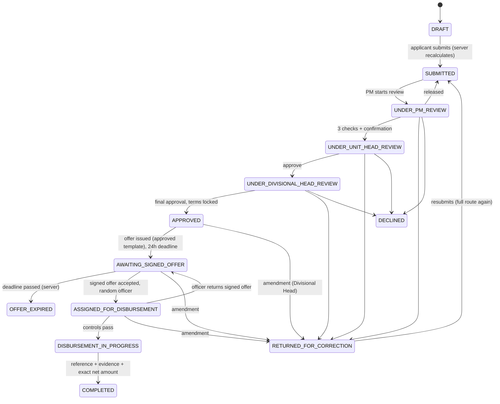

# Staff Personal Financing

An end-to-end workflow for bank staff, from origination to disbursement and post-completion
documentation, inside the Retail Asset Factory. It has its own records and statuses (it never touches
customer applications, their statuses or reports) and reuses the platform's sign-in, roles, audit trail,
email outbox, encrypted document storage, malware scanning, offer-template approval and background worker.

## 1. What is implemented, and what waits on the bank

| Area | State |
|---|---|
| Origination, live calculator, server recalculation, acknowledgement, drafts, submission | Implemented |
| Product Manager review with mandatory manual checklist, Unit Head, Divisional Head | Implemented |
| Returns, declines, resubmission, controlled amendment of approved terms | Implemented |
| Offer letter generation, 24-hour acceptance enforced on the server, expiry job, reminder | Implemented; **waits for the bank's approved offer wording** (section 7) |
| Random Disbursement Officer assignment, reassignment, financial controls, idempotent completion | Implemented as a **manual, evidenced** process (no payment API is connected) |
| ZIP documentation archive, encrypted storage, integrity check | Implemented |
| Microsoft SharePoint upload and verification, retries, alerts | Implemented as an integration boundary; **inactive until credentials are issued** (section 8) |
| Legal and Shariah handover with tracked receipt and review | Implemented (in-platform queues; email is notification only) |
| Account, salary history and repayment-capacity checks | **Manual** by the Product Manager: no payroll, core-banking or identity API is connected, and nothing marks them as passed automatically |

## 2. Routes

| Route | Who | Purpose |
|---|---|---|
| `/staff-request` | Any signed-in staff | My staff financing: list, offers requiring action, new request (was a placeholder) |
| `/staff-request/[id]` | Applicant and authorised reviewers | Origination form and calculator (draft / returned), request detail, role-specific action panel, documents, decisions, timeline |
| `/staff-financing` | Product Manager, Unit Head, Divisional Head, Disbursement Officers, Legal/Shariah reviewers, Super Admin | Role queues and dashboards (`?view=pm|uh|dh|do|docs|ops`), search, status filter, pagination |
| `/admin/staff-financing` | Super Admin | Settings versions, offer template wording, SharePoint status, role coverage |
| `POST /api/staff-requests/upload` | Session | Upload with progress (same-origin) |
| `GET /api/staff-requests/documents/[id]` | Session + signed link | View/download a document (access re-checked, audited) |
| `GET /api/staff-requests/[id]/archive` | Super Admin, Legal, Shariah | Download the ZIP archive (integrity-checked, audited; a reviewer's first download records receipt) |
| `/enter/staff-personal-request` (unchanged) | Landing card | Sign in, then `/staff-request` |

Modified: the app layout (navigation section "Staff financing"), `/queue` (a person whose only role is
Staff member goes to `/staff-request`), Offer templates (now also lists the staff template).

## 3. Data model (`migrations/007_staff_personal_financing.sql`)

| Table | Purpose |
|---|---|
| `staff_financing_settings` | Versioned, append-only: deduction rate (v1: 2%), optional min/max amount, tenor options, documents required at submission |
| `staff_requests` | One row per request: applicant snapshot, figures (gross, rate, deduction, net), tenor, acknowledgements, review assignments, approval and frozen `approved_terms` + SHA-256, offer issue/deadline, signed offer, disbursement record, documentation status and retry state |
| `staff_request_documents` | Private object storage keys (no personal data in keys), scan status, category, uploader |
| `staff_request_reviews` | Append-only decisions: stage, action, checklist (PM), recommendation, comments, designated Unit Head, status change |
| `staff_request_events` | Append-only status history: action, previous/new status, actor, role, queue, outcome, comments, document references |
| `staff_request_assignments` | Disbursement assignment history (random or admin reassignment, eligible count, reason); one active assignment per request |
| `staff_request_archives` | The ZIP: filename, storage key, SHA-256, size, manifest |
| `staff_request_sharepoint` | Delivery record: folder, attempts, last error, Graph item id, uploaded/verified times |
| `staff_request_handovers`, `staff_request_handover_groups` | One handover per facility; per group (Legal, Shariah): sent → received → reviewed, by whom, when, comments |

Also: `audit_events.staff_request_id`, `notification_outbox.staff_request_id`, offer template type `STAFF`.
Database guards: approved terms cannot change while an approval stands (trigger); completion requires the
transaction reference, disbursement time and an amount equal to the net amount; transaction references
are unique across all requests; disbursement statuses require final approval and a signed offer.

## 4. Services (server)

| Module | Functions |
|---|---|
| `src/lib/staff-financing.ts` | `computeStaffFinancing` (integer kobo, half-up rounding), labels, statuses |
| `src/server/staff/requests.ts` | `createStaffDraft`, `saveStaffDraft`, `submitStaffRequest`, `claimPmReview`, `releasePmReview`, `pmDecision`, `unitHeadDecision`, `divisionalHeadDecision`, `amendApproval`, `eligibleUnitHeads` |
| `src/server/staff/offer.ts` | `issueOffer`, `submitSignedOffer`, `expireStaffOffers`, `remindStaffOffers`, `retryBlockedOffers`, `createStaffTemplateVersion` |
| `src/server/staff/disbursement.ts` | `assignDisbursementOfficer` (random), `reassignDisbursementOfficer`, `reviewDisbursementDocumentation`, `returnSignedOffer`, `startDisbursement`, `completeDisbursement`, `disbursementControls` |
| `src/server/staff/pipeline.ts` | `buildArchive`, `advanceDocumentation`, `processStaffDocumentation`, `confirmHandoverReceipt`, `completeHandoverReview`, `readArchive` |
| `src/server/staff/sharepoint.ts` | `GraphDocumentLibrary` (token, upload, upload session, verify) |
| `src/server/staff/core.ts` | Transitions + events + audit, access control, separation of duties, notifications |
| `src/app/(app)/staff-request/actions.ts` | Server actions for every screen action |

The worker (`src/server/jobs/worker.ts`) runs on each tick: offer expiry, deadline reminders, blocked offer
retries, quarantined scans and due documentation steps. Every transition re-checks the expected status
and an optimistic lock inside a database transaction.

## 5. Roles and permissions

| Action | Applicant | Product Manager | Unit Head | Divisional Head | Disbursement Officer | Legal / Shariah | Super Admin |
|---|---|---|---|---|---|---|---|
| Create, edit, submit own request | ✓ | | | | | | |
| View request | own | submitted requests | designated / decided | after Unit Head approval | assigned | after handover | all |
| Start review, checklist, forward / return / decline | | ✓ (not own) | | | | | release only |
| Approve and forward / return / decline | | | designated only | | | | |
| Final approval / return / decline; amendment | | | | ✓ (not own) | | | |
| Sign and return offer | ✓ | | | | | | |
| Review documents, return, process, complete disbursement | | | | | assigned only | | |
| Reassign Disbursement Officer, retry offer / documentation | | | | | | | ✓ |
| Download archive, confirm receipt, record review | | | | | | own group | download |

Separation of duties (enforced on the server): nobody acts on their own request; one person never fills
two of Product Manager, Unit Head, Divisional Head and Disbursement Officer on the same request; random
assignment excludes the applicant and earlier approvers. Refused attempts are recorded as `DENIED` audit events.
New roles: **Product Manager (staff financing)** and **Staff member (personal financing)**; employees with no
other role need the latter to sign in. Existing roles reused: Unit Head, Divisional Head, Disbursement
Officer 1/2, Legal and Shariah reviewers.

## 6. Status transitions

Documentation status (separate, after COMPLETED): `PREPARING_ARCHIVE` → (`AWAITING_SHAREPOINT` when
configured) → `SENT_TO_LEGAL_SHARIAH` → `RECEIVED_BY_LEGAL_SHARIAH` → `REVIEW_COMPLETED`.

## 7. Calculator and offer letter

Gross = amount requested; deduction = gross × 2% (settings v1) rounded half-up to the kobo; net = gross −
deduction. Shown live before Submit, with commas, two decimals and ₦; the applicant must acknowledge the
exact net figure. The server recalculates at every save and at submission, refuses a stale acknowledgement,
and stores gross, rate, deduction and net. At final approval the terms are frozen and fingerprinted.

The offer is generated only from the **active staff template that the bank has approved for production**.
The seeded template is placeholder wording and is not approved, so no offer is issued in production until a
Super Admin loads the bank's Legal and Shariah wording and records its approval. Placeholders available:
`ref, offer_date, approval_date, acceptance_deadline, staff_name, staff_id, department, unit, approved_amount,
deduction_rate, deduction_amount, net_amount, tenor, salary_account, salary_account_name`.

## 8. Microsoft SharePoint: configuration required

1. Register an application in Microsoft Entra ID (single tenant) for the platform.
2. Grant **Microsoft Graph application permission `Sites.Selected`** (admin consent), then grant that app
   `write` access to the one target site only (`POST /sites/{site-id}/permissions`). Do not grant
   `Sites.ReadWrite.All` or `Files.ReadWrite.All`.
3. Create the document library (or use an existing one) with the bank's retention label and permissions
   limited to authorised staff. Look up its drive id: `GET /sites/{site-id}/drives`.
4. Set on the background worker: `SHAREPOINT_ENABLED=true`, `SHAREPOINT_TENANT_ID`, `SHAREPOINT_CLIENT_ID`,
   `SHAREPOINT_CLIENT_SECRET` (or rotate to a certificate later), `SHAREPOINT_DRIVE_ID`, optionally
   `SHAREPOINT_ROOT_FOLDER` (default `ARAF Staff Financing`).
5. Allow outbound HTTPS to `login.microsoftonline.com` and `graph.microsoft.com` from the worker.

Behaviour: path `<root>/STAFF-<staff ID>/ARAF-STAFF-<reference>.zip` (no names, accounts or amounts in
paths); upload with `conflictBehavior=fail` (chunked upload session above 4 MB); verified by downloading
and comparing SHA-256 and size; no sharing links are created. Failures are recorded on the request,
retried with back-off (1, 2, 4 … 60 minutes), and alerted to Super Admins on the first and every fifth
failure. The handover waits until the upload is verified. When SharePoint is **not configured**, the
archive stays in the platform's encrypted storage, the request records "SharePoint not configured", and
the handover proceeds from there. Retention and access logging in SharePoint follow the library's policy.

## 9. Legal and Shariah handover

Created automatically once the archive is stored (and verified in SharePoint when configured). One handover
record links the archive, its checksum and the SharePoint item; each group (Legal, Shariah) has its own
state. Holders of the Legal / Shariah reviewer roles and the configured closure recipients are notified by
email (reference and link only). Delivery is tracked in the platform: a group is **received** when a
reviewer downloads the archive or confirms receipt, and **reviewed** when they record the outcome. Email
alone is never treated as delivery. The financing status stays **Completed** throughout; the documentation
status moves separately to "Sent to Legal and Shariah for Review", "Received" and "Review completed".
If nobody holds a reviewer role, Super Admins are alerted.

## 10. Notifications

Applicant: submitted, returned, declined, approved, offer issued, deadline reminder (4 hours before),
expired, signed offer received, signed offer returned, disbursed. Queues: Product Managers on submission,
the designated Unit Head, Divisional Heads, the assigned Disbursement Officer, Legal and Shariah. Super
Admins: blocked offers, no eligible officer, SharePoint failures, missing reviewers. Emails carry the
reference, the step and a sign-in link; never amounts or account numbers.

## 11. Audit

Every change writes a `staff_request_events` row (previous and new status, actor, role, queue, outcome,
comments, document references) and an `audit_events` row linked by `staff_request_id`, in the same
transaction. Both tables are append-only. Document views and downloads, archive downloads and refused
attempts are audited. The archive contains `06-records/audit-report.csv`.

## 12. Design

Screens use the V39 system (docs/DESIGN.md): Nunito Sans / DM Sans, tokens, Light/Dark/System. Reused:
cards, metric tiles, tables with stacked mobile rows, badges with icons, tabs, filters, pagination,
`ActionForm`, `ReasonAction`, `AmountInput`, timeline, checklist ticks, alerts, modal dialogs. New: the
brand-coloured calculator card (same treatment as the request wallet), checklist gate, countdown chip,
document rows and an upload control with progress and retry.

## 13. Tests

`tests/staff-financing.test.ts` (19 tests) covers the calculator and scenarios A–F and H at the domain level,
including the database terms lock and amendment. A browser run of the production build drives the same
journey through the screens (calculator, gates, dialogs, signing, disbursement, access denial). Scenario G is
covered by rendering every staff screen in Light, Dark and System (dark OS) at ten widths, with no overflow,
console errors or WCAG AA contrast failures.

## 14. Decisions to confirm and open dependencies

- **Offer wording**: the bank's approved Legal and Shariah staff offer template must be loaded and approved.
- **SharePoint**: Entra ID app, `Sites.Selected` grant and the library (section 8).
- **Payment**: no payment API exists; disbursement is recorded from core banking with evidence.
- **Payroll / core banking / identity**: not connected; staff ID, phone and salary account are entered by the
  applicant and verified manually by the Product Manager.
- **Provisioning**: every applicant must be provisioned (Users & roles) with at least the Staff member role.
- **Authority assumptions to confirm**: the Product Manager may decline (as specified); the Unit Head is chosen
  by the Product Manager from Unit Head role holders (the one whose unit matches is suggested); any Divisional
  Head may give final approval; Disbursement Officer 1 and 2 roles are both eligible; a Divisional Head may
  withdraw an approval for amendment before disbursement starts; a signed offer returned by the Disbursement
  Officer keeps the original 24-hour deadline.
- **Settings**: amount limits, tenor options and mandatory documents are not specified and are empty until a
  Super Admin records them (with source) as a new settings version.
